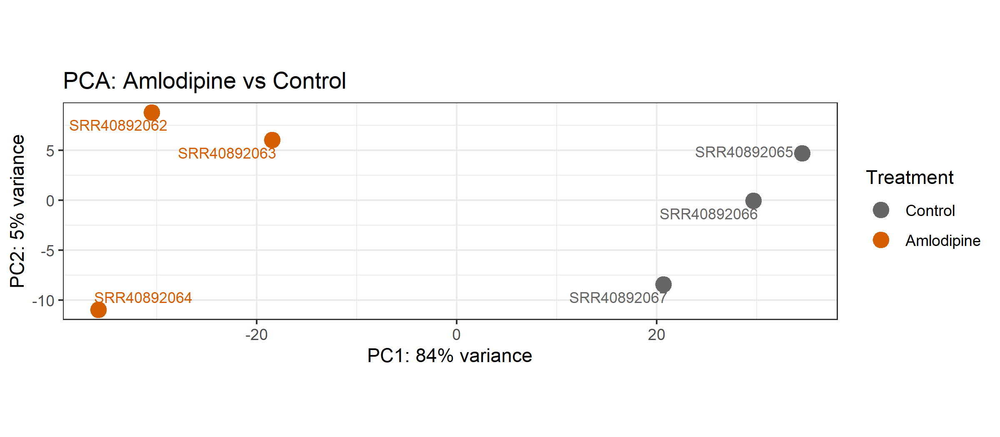
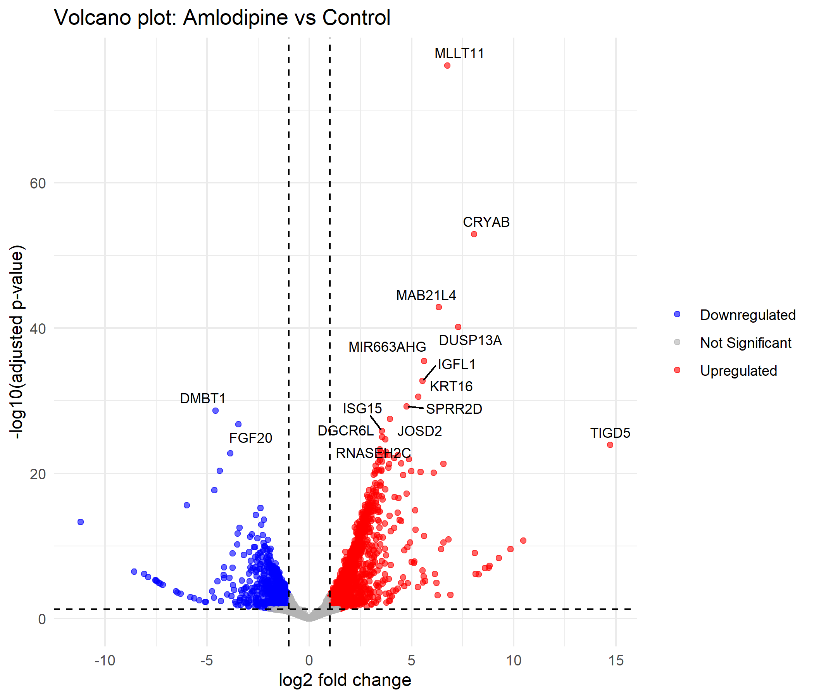
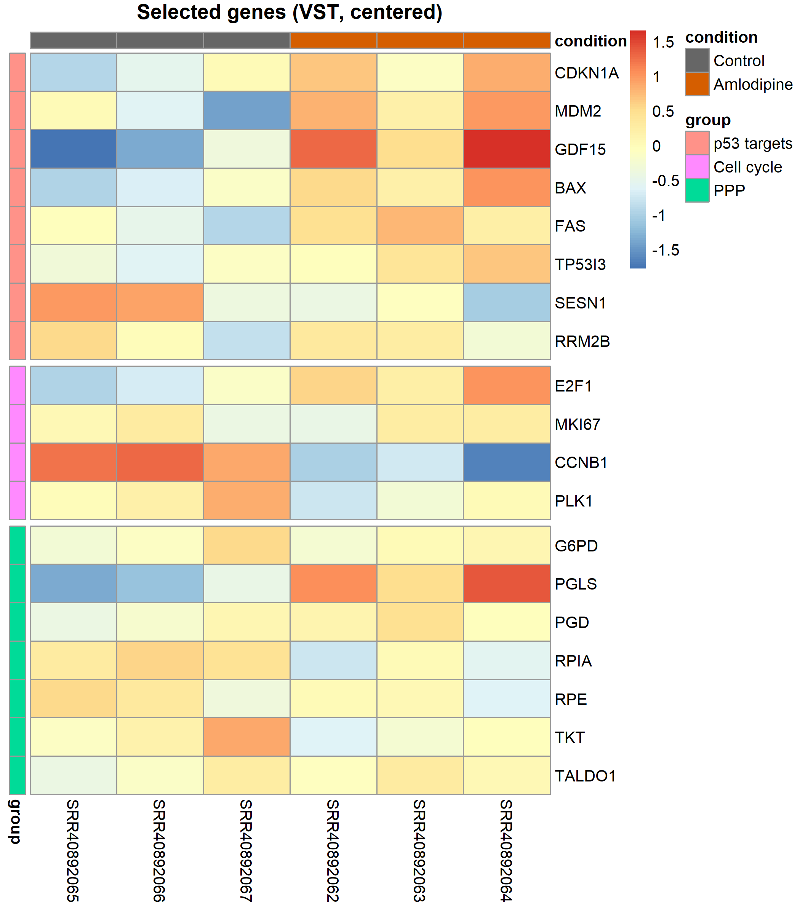

# RNA-seq pipeline: amlodipine in AGS gastric cancer cells

A Snakemake workflow that reanalyses public RNA-seq data on the effect of the calcium
channel blocker amlodipine in AGS human gastric adenocarcinoma cells. It takes paired-end
runs from SRA through quality control, Salmon quantification against GENCODE, differential
expression with DESeq2, and GO and Hallmark enrichment in R.

The data come from [GSE348880](https://www.ncbi.nlm.nih.gov/geo/query/acc.cgi?acc=GSE348880).
AGS cells were treated with 5 µM amlodipine or a DMSO vehicle control for 48 h, with three
independent biological replicates per group. The original study investigated the anti-tumour
effect of amlodipine, with a focus on changes in the pentose phosphate pathway (PPP) mediated
by transketolase (TKT). This reanalysis looks at the PPP directly as well as genome-wide.

The GEO record does not state the library preparation. The data are consistent with poly-A
selection: replication-dependent histone mRNAs, which lack poly-A tails, are not detected
above the low-count filter.

## Results at a glance

Treatment is the dominant source of variation (PC1, 83% of variance), and samples cluster
cleanly by condition.



In this reanalysis, TKT mRNA is modestly lower after amlodipine treatment (log2FC −0.55,
nominal p = 0.048, padj = 0.13), and the non-oxidative PPP gene set trends downward with
TKT in its leading edge (NES −1.19, p = 0.29). Neither result passes the significance
thresholds used here. At the transcript level, the data are directionally consistent with
reduced non-oxidative PPP activity but do not establish it. The original study's TKT
findings may rest on protein- or activity-level evidence not captured by RNA-seq.
At padj < 0.05 and |log2FC| > 1, there are **1977 upregulated** and **1003 downregulated** genes.



Pathway analysis points to p53 activation (CDKN1A, MDM2, GDF15, BAX up) together with
suppression of G2/M checkpoint and E2F target genes, consistent with cell-cycle arrest.
Oxidative phosphorylation and mitochondrial organisation gene sets are enriched among
upregulated genes. With three replicates per group, treat these as hypotheses to follow up.

For comparison with the original study, the PPP genes are shown in the heatmap below.
Gene-set results for the oxidative and non-oxidative PPP branches are in
`results/tables/GSEA_PPP_branches.csv`.



## Workflow

```
SRA accessions ──► fasterq-dump ──► FastQC ──────────────┐
                        │                                 ├──► MultiQC
GENCODE transcripts ──► salmon index ──► salmon quant ───┘
                                               │
                                               ▼
                    04_deseq2.R ──► 05_qc_plots.R ──► 06_enrichment.R
```

| Step | Tool | Where |
|------|------|-------|
| Download reads | SRA Toolkit (`fasterq-dump`) | rule `download_fastq` |
| Read QC | FastQC, MultiQC | rules `fastqc`, `multiqc` |
| Reference | GENCODE human transcriptome (release 50) | rule `download_transcriptome` |
| Indexing & quantification | Salmon | rules `salmon_index`, `salmon_quant` |
| Differential expression | tximport, DESeq2, apeglm | `scripts/04_deseq2.R` |
| Figures | ggplot2, pheatmap | `scripts/05_qc_plots.R` |
| Enrichment | clusterProfiler, MSigDB Hallmark | `scripts/06_enrichment.R` |

The R steps run in order via `scripts/run_all.R`, which the `r_analysis` rule calls.

## Data

| Run | Condition |
|-----|-----------|
| SRR40892062 | Amlodipine |
| SRR40892063 | Amlodipine |
| SRR40892064 | Amlodipine |
| SRR40892065 | Control |
| SRR40892066 | Control |
| SRR40892067 | Control |

Samples are defined in `metadata/samples.csv` with columns `sample` (SRA run accession)
and `condition`. `Control` refers to the DMSO vehicle control.

## Requirements

- [Conda](https://docs.conda.io) or [Mamba](https://mamba.readthedocs.io)
- [Snakemake](https://snakemake.readthedocs.io) <!-- TODO: version you tested with -->
- Disk space for uncompressed FASTQ files and a human Salmon index (several GB). Raw FASTQs
  are marked `temp()` and are deleted once quantification and QC have finished.
- For Hallmark GSEA: the MSigDB Hallmark gene sets as gene symbols
  (`h.all.v*.Hs.symbols.gmt`), downloaded from
  [MSigDB](https://www.gsea-msigdb.org/gsea/msigdb) into `metadata/`. If the file is
  missing, this step is skipped.

All other tools are installed from the environment files in `envs/`.

## Usage

```bash
git clone https://github.com/SometimesJade/rna-seq-pipeline.git
cd rna-seq-pipeline

# Dry run: show which jobs would be executed
snakemake --use-conda --cores 8 -n

# Full run
snakemake --use-conda --cores 8
```

To rerun only the R analysis on existing quantifications:

```bash
Rscript scripts/run_all.R
```

## Configuration

Pipeline settings live in two places:

- `Snakefile`: `GENCODE_RELEASE` and per-rule thread counts.
- `scripts/config.R`: reference and treatment levels, significance thresholds
  (`padj_cutoff = 0.05`, `lfc_cutoff = 1`), the low-count filter (≥ 10 counts in
  ≥ 3 samples), plot colours, and the random seed.

## Outputs

### Tables (`results/tables/`)

| File | Contents |
|------|----------|
| `DE_amlodipine_vs_control.csv` | DESeq2 results: gene ID, symbol, baseMean, shrunken log2FC, p-value, padj, DE call |
| `normalized_counts.csv` | DESeq2 size-factor normalised counts |
| `GO_ORA_upregulated.csv`, `GO_ORA_downregulated.csv` | GO BP over-representation results |
| `GSEA_GO_BP.csv` | GSEA against GO Biological Process |
| `GSEA_Hallmark.csv` | GSEA against MSigDB Hallmark gene sets |
| `GSEA_PPP_branches.csv` | GSEA for oxidative and non-oxidative pentose phosphate pathway genes |

### Figures (`results/figures/`)

| File | Contents |
|------|----------|
| `01_pca.png` | PCA of variance-stabilised counts |
| `02_sample_distances.png` | Sample-to-sample distance heatmap |
| `03_ma_plot.png` | MA plot with apeglm-shrunken fold changes |
| `04_volcano.png` | Volcano plot, top 15 DE genes labelled |
| `05_genes_of_interest_heatmap.png` | p53 targets, cell-cycle and PPP genes (VST, centred) |
| `06_GO_ORA_*.png` | GO ORA dot plots (only written when terms are significant) |
| `07_GSEA_GO_BP.png` | GO GSEA, activated vs suppressed |
| `08_GSEA_Hallmark.png` | Hallmark GSEA, activated vs suppressed |
| `09_HALLMARK_*.png` | Running enrichment plots for G2M checkpoint and oxidative phosphorylation |

### Other

| Path | Contents |
|------|----------|
| `results/qc/multiqc_report.html` | Combined FastQC and Salmon QC report |
| `results/rds/` | Intermediate R objects (`dds`, `vsd`, `res`, `res_df`) |
| `results/sessionInfo.txt` | R package versions used |
| `quants/{sample}_quant/` | Salmon quantifications |
| `logs/` | Log file for every rule and sample |

## Analysis details

- **Gene-level summarisation:** transcripts are aggregated to genes with tximport, using
  a transcript-to-gene map parsed from the GENCODE FASTA headers.
- **Filtering:** structural and small RNA biotypes (rRNA, Mt_tRNA, snRNA, snoRNA,
  misc_RNA and others) are removed, since poly-A-selected libraries don't capture them
  reliably. Genes with fewer than 10 counts in at least 3 samples are also removed.
- **Differential expression:** DESeq2 with design `~ condition`, `Control` as the
  reference level. Fold changes are shrunk with apeglm for ranking and plotting.
- **DE calls:** padj < 0.05 and |log2FC| > 1.
- **GO over-representation:** `enrichGO` (Biological Process) run separately on up- and
  downregulated genes, with all tested genes as the background. Redundant terms are
  reduced with `simplify()`.
- **GSEA:** genes ranked by the unshrunken DESeq2 Wald statistic and tested against GO BP
  (`gseGO`), MSigDB Hallmark, and custom pentose phosphate pathway gene sets.

## Repository structure

```
├── Snakefile            # Workflow definition (download → QC → quantification → R)
├── envs/                # Conda environment per rule
├── metadata/            # Sample sheet and Hallmark GMT
├── scripts/
│   ├── config.R         # Shared paths, thresholds and settings
│   ├── 04_deseq2.R      # Import, filtering, differential expression
│   ├── 05_qc_plots.R    # PCA, distances, MA, volcano, heatmaps
│   ├── 06_enrichment.R  # GO ORA and GSEA
│   └── run_all.R        # Runs steps 04–06 and records sessionInfo
└── results/             # Tables, figures, QC report
```

## Citation

If you use this workflow, please cite the underlying tools: Snakemake, SRA Toolkit,
FastQC, MultiQC, Salmon, tximport, DESeq2, apeglm, clusterProfiler, enrichplot, and
MSigDB (Hallmark gene sets).
